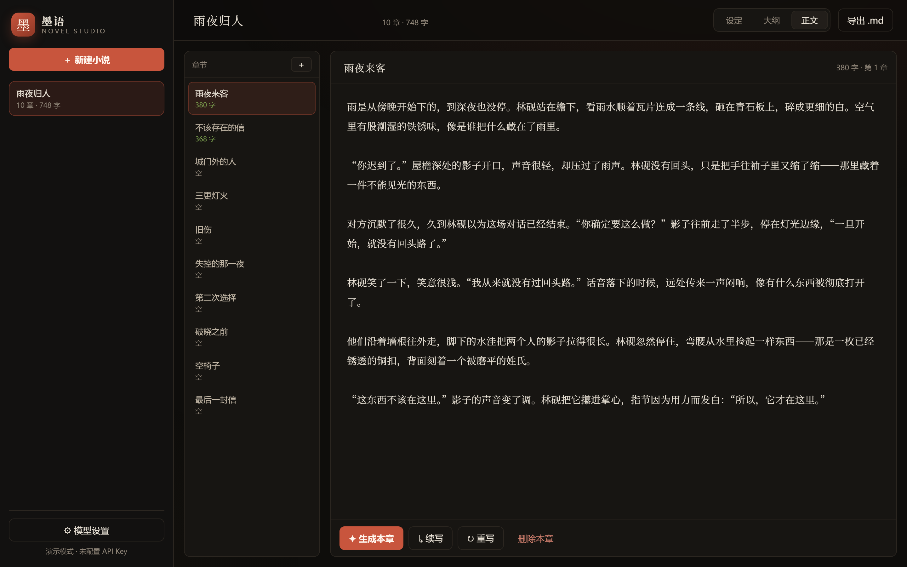
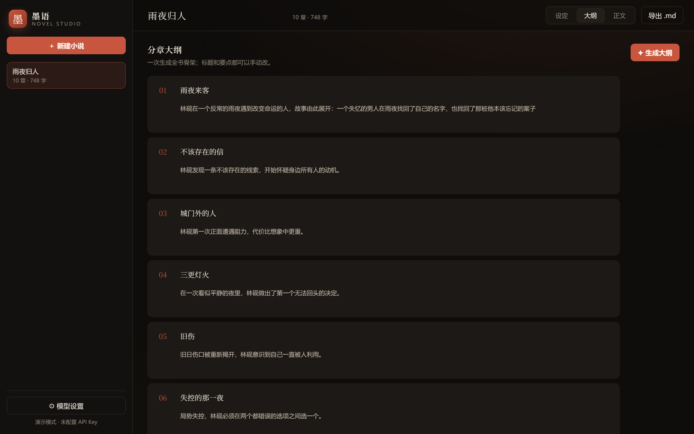

# 墨语 · Novel Studio

> 一个 **零依赖** 的 AI 长篇小说生成器：从「一句话梗概」到「分章大纲」再到「逐章正文」，全流程流式生成，本地存储，一键导出。



<p align="center"><sub>正文创作界面 · 左侧章节列表，右侧流式生成</sub></p>



<p align="center"><sub>分章大纲 · 可手动修改标题与要点</sub></p>

---

## 这个项目解决什么问题

用大模型写长篇小说，难点从来不是「生成一段文字」，而是：

1. **长文跑偏** —— 写第三章的时候，模型已经忘了第一章的设定；
2. **结构失控** —— 没有大纲，越写越散，章节长度忽长忽短；
3. **体验割裂** —— 一次等 60 秒才看到结果，改一个字要重来。

这个项目用 **「设定 → 大纲 → 正文」三级流水线 + 分层上下文** 来解决：每一层都把上层结果压缩后喂给下一层，既保证一致性，又不至于把整本书塞进提示词。

## 功能

| 模块 | 说明 |
| --- | --- |
| 故事设定 | 题材、文风、视角、梗概、世界观、主角、额外要求，全部参与提示词 |
| 分章大纲 | 一键生成 N 章骨架（标题 + 剧情要点），可直接编辑 |
| 正文生成 | 单章生成 / 续写 / 重写，SSE 流式输出，打字机效果 |
| 手动编辑 | 标题与正文均可改，自动保存（防抖 900ms） |
| 多作品管理 | 左侧书架，作品之间互不干扰 |
| 导出 | 一键下载 Markdown（或调用 API 拿 TXT） |
| 模型设置 | 兼容任意 OpenAI 格式接口，Key 仅保存在本机 |
| 演示模式 | 没配 API Key 也能跑完整流程，方便演示与验收 |
| 冒烟测试 | `tests/smoke_test.py` 覆盖 8 个核心接口 |

## 快速开始

只需要 **Python 3.8+**，不用安装任何第三方包：

```bash
git clone https://github.com/<你的用户名>/novel-studio.git
cd novel-studio
python app.py
```

浏览器打开 <http://127.0.0.1:8765> → 点「＋ 新建小说」→ 填设定 → 生成大纲 → 写正文。

想把端口换掉：

```bash
python app.py --port 9000
```

### 接入真实模型

点左下角 **⚙ 模型设置**，填入任意 OpenAI 兼容服务：

| 字段 | 示例 |
| --- | --- |
| base_url | `https://api.deepseek.com/v1` |
| model | `deepseek-chat` |
| api_key | `sk-...` |

保存后左下角会变成绿色的「已连接」。配置写入 `data/settings.json`，该目录已在 `.gitignore` 中，不会被提交。

## 项目结构

```
novel-studio/
├── app.py                  # 启动入口（参数解析）
├── novelgen/
│   ├── store.py            # JSON 存储：作品 / 章节 / 设置，原子写入
│   ├── prompts.py          # 提示词工程：大纲、正文、续写
│   ├── llm.py              # OpenAI 兼容接口的流式客户端（urllib）
│   ├── demo.py             # 无 Key 时的离线演示文本
│   └── server.py           # HTTP 服务：REST + SSE 路由
├── web/
│   ├── index.html          # 单页 UI
│   ├── styles.css          # 手写样式（无框架、无构建）
│   └── app.js              # 原生 JS：状态管理 + SSE 解析
├── tests/smoke_test.py     # 端到端冒烟测试
├── data/                   # 运行时数据（git 忽略）
└── docs/                   # 截图
```

## 接口一览

| 方法 | 路径 | 说明 |
| --- | --- | --- |
| GET | `/api/health` | 健康检查 |
| GET/PUT | `/api/settings` | 读取 / 保存模型设置 |
| GET/POST | `/api/projects` | 作品列表 / 新建 |
| GET/PATCH/DELETE | `/api/projects/<id>` | 作品详情 / 修改 / 删除 |
| POST | `/api/projects/<id>/outline` | **SSE** 生成大纲 |
| POST | `/api/projects/<id>/chapters` | 新增章节 |
| PUT/DELETE | `/api/projects/<id>/chapters/<i>` | 保存 / 删除章节 |
| POST | `/api/projects/<id>/chapters/<i>/write` | **SSE** 生成 / 续写 / 重写 |
| GET | `/api/projects/<id>/export?format=md` | 导出 |

SSE 消息格式：

```text
data: {"delta": "雨是从傍晚开始下的"}     ← 增量文本
data: {"event": "saved", "word_count": 2873}  ← 结构化事件
data: [DONE]
```

## 几个可以聊的设计取舍

1. **为什么零依赖？**
   用 `http.server` + `urllib` 手写，而不是 Flask/FastAPI。代价是代码量大一些，好处是 clone 下来就能跑、没有 `pip install` 失败的风险，也逼着自己把 HTTP、SSE、分块传输这些底层机制搞清楚。

2. **上下文怎么控制？**
   写第 N 章时，只喂「设定 + 全书大纲（一行一章）+ 本章要点 + 最近两章的结尾 300 字」。既保留了前情，又不会让 token 随章节数线性爆炸。

3. **模型输出不可靠怎么办？**
   大纲要求模型输出 JSON，但实际经常带 ```json 代码块或多余说明。`parse_outline()` 先剥代码块、再截取 `[...]` 解析，全部失败时退化为正则按行提取「1. 标题：要点」——保证不会因为一次格式化问题让整个功能不可用。

4. **数据安全**
   存储用「临时文件 + `os.replace`」原子替换，写到一半断电也不会留下半个 JSON；`api_key` 只在服务端使用，接口读设置时只返回 `has_key` 布尔值，不回传明文。

5. **没有 API Key 也要能演示**
   `demo.py` 用模板拼出大纲和正文，并按 8 个字符切片模拟流式。面试官/评审 clone 后不用申请密钥就能看到完整交互。

## 测试

```bash
python tests/smoke_test.py
```

会在随机端口起一个真实服务，跑完「建作品 → 存设定 → 流式大纲 → 流式正文 → 导出 → 删除」全链路。

## 路线图

- [ ] 人物卡与世界观词条库（保证人设不崩）
- [ ] 章节 diff 改写（保留原稿、对比新旧）
- [ ] 导出 EPUB / DOCX
- [ ] 多模型并排对比生成
- [ ] Docker 一键部署

## 已知限制

- 单用户本地应用，没有账号体系与并发锁；
- 长章节（> 8000 字）需要靠「续写」多次拼接；
- 大纲质量高度依赖所选模型。

## License

[MIT](LICENSE) © 2026
